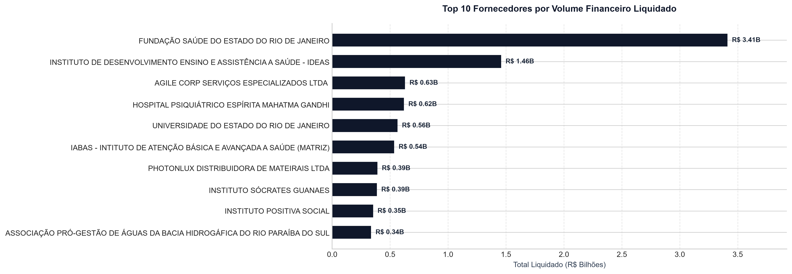
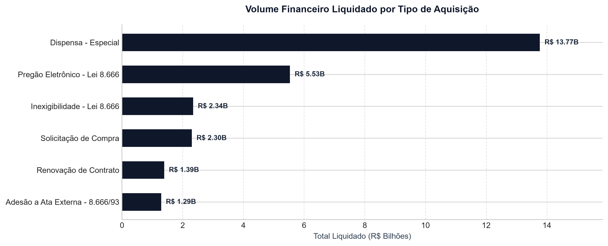

# Pipeline ETL e Análise de Compras Públicas — Estado do Rio de Janeiro

Projeto desenvolvido como prova técnica de Engenharia e Análise de Dados, focado na ingestão, higienização, tipagem estrita, auditoria relacional e análise exploratória dos dados de contratações do Estado do Rio de Janeiro (SIGA / Portal de Compras).

---

## 1\. Visão Geral e Arquitetura

O projeto adota uma arquitetura modular desacoplada baseada no **Princípio da Responsabilidade Única (SRP)**, separando o ciclo de vida dos dados em módulos funcionais e garantindo que o relatório exploratório apenas consuma dados previamente tratados e auditados.

```
Prova-CGE/
├── data/
│   ├── raw/                 # Dados brutos (CONTRATOS.zip)
│   └── processed/           # Camada tratada persistida em Apache Parquet
│       ├── contratos.parquet
│       └── itens.parquet
├── docs/                    # Gráficos executivos para documentação
│   ├── curva_abc.png
│   └── modalidades_aquisicao.png
├── notebooks/
│   └── 01_analise_contratos.ipynb  # Relatório analítico e visualizações executivas
├── src/
│   ├── __init__.py
│   ├── extract.py           # Ingestão em streaming diretamente do ZIP em memória
│   ├── transform.py         # Higienização, tipagem estrita e deduplicação
│   └── load.py              # Persistência colunar Parquet compactada com Snappy
├── .gitignore
├── main.py                  # Orquestrador de ponta a ponta do pipeline
├── PRD.md                   # Documento de Requisitos de Engenharia e Negócio
├── README.md                # Instruções de reprodução e defesa técnica
└── requirements.txt         # Dependências mínimas essenciais
```

### Decisões de Engenharia de Dados

* **Processamento em Memória (Streaming):** O extrator lê os arquivos CSV compactados diretamente na memória sem necessidade de descompactar arquivos volumosos em disco, otimizando o I/O.  
* **Vetorização Nativa:** Todas as rotinas de limpeza numérica, remoção de caracteres e conversão temporal utilizam operações vetorizadas do Pandas/NumPy em C/Cython, processando **474.784 registros em aproximadamente 2,0 segundos**.  
* **Armazenamento Colunar (Parquet):** A persistência dos dados tratados é realizada em Apache Parquet com compressão Snappy, reduzindo o espaço em disco e acelerando as consultas analíticas subsequentes.  
* **Minimização de Dependências (*Clean Environment*):** A formatação de tabelas analíticas no Jupyter Notebook foi desenvolvida de forma nativa com Pandas, dispensando bibliotecas adicionais como Jinja2 e mantendo o ambiente enxuto e estável.

---

## 2\. Instruções de Configuração e Execução

### Pré-requisitos

* Python 3.11 ou superior (desenvolvido e testado em Python 3.13)  
* Arquivo bruto `CONTRATOS.zip` posicionado em `data/raw/`

### Passo a Passo

1. **Acessar o diretório do projeto:**

```sh
cd Prova-CGE
```

2. **Criar e ativar o ambiente virtual:**

```sh
# Windows (Git Bash / PowerShell)
python -m venv .venv
source .venv/Scripts/activate

# Linux / macOS
python3 -m venv .venv
source .venv/bin/activate
```

3. **Instalar as dependências essenciais:**

```sh
pip install -r requirements.txt
```

4. **Executar o Pipeline de ETL:**

```sh
python main.py
```

   *O pipeline extrai, trata, deduplica e salva os arquivos `contratos.parquet` e `itens.parquet` na pasta `data/processed/`.*

   

5. **Executar o Relatório Analítico:** Inicie o Jupyter Notebook ou abra no VS Code: `notebooks/01_analise_contratos.ipynb`

---

## 3\. Auditoria de Qualidade e Governança de Dados (Data Quality)

* **Deduplicação (Contratos):** 0 duplicados. A chave `contratacao` é única, qualificando-se formalmente como Chave Primária (PK).  
* **Deduplicação (Itens):** 747 expurgados. Identificação de linhas idênticas redundantes da extração do SIGA. Base consolidada em 343.526 itens.  
* **Integridade Referencial:** 100,00% (1:N). Todos os itens possuem correspondência exata em um contrato pai; zero itens órfãos identificados.  
* **Semântica dos Nulos:** Conforme Lei 4.320/64. A ausência de valor em empenho (57,5%) e liquidação (69,7%) decorre do funil orçamentário regular de Atas de Registro de Preços.  
* **Estornos e Supressões:** Preservados. Preservação contábil de 169 estornos orçamentários e 243 supressões de itens para assegurar a exatidão dos balanços.  
* **Anomalias de Preço:** Sinalizadas. Criação da coluna booleana `flag_inconsistencia_preco` para isolar 26 itens com preço `-,0003` (Ata Webtrip).

---

## 4\. Indicadores de Gestão e Descobertas Analíticas

As análises visuais do projeto revelam o comportamento dos gastos públicos do Estado do Rio de Janeiro:

1. **Funil de Execução Orçamentária:**  
     
   * **Estimado (Edital):** R\$ 140,41 Bi  
   * **Empenhado (Reserva):** R\$ 56,34 Bi  
   * **Liquidado (Executado):** R\$ 32,72 Bi  
   * **Efetivamente Pago:** R\$ 29,62 Bi  
   * **Diagnóstico:** Conversão de 23,31% das estimativas em despesa liquidada, reflexo da natureza de teto das Atas de Registro de Preços. Uma vez liquidada a despesa, a taxa de pagamento alcança 90,53%, atestando baixo volume de restos a pagar processados pendentes.

   

2. **Série Temporal de Despesas Públicas (2010–2024):**  
     
   * Mapeamento do salto orçamentário no triênio 2020–2022 (R\$ 6,3 Bi a R\$ 6,4 Bi anuais liquidados), decorrente das contratações emergenciais de combate à crise sanitária de COVID-19.

   

3. **Curva ABC de Fornecedores (Princípio de Pareto):**  
     
   * Os 10 maiores prestadores concentram **26,54%** de todo o orçamento liquidado do Estado (R\$ 8,68 Bi de R\$ 32,72 Bi).  
   * Liderança expressiva de Organizações Sociais de Saúde (OSS) e órgãos públicos de assistência médica (Fundação Saúde do Estado do RJ com R\$ 3,41 Bi e Instituto IDEAS com R\$ 1,46 Bi).  
   

   

4. **Distribuição por Modalidade de Aquisição:**  
     
   * A **Dispensa \- Especial** lidera o volume financeiro liquidado com **42,07%** do montante total (R\$ 13,77 Bi em 10.442 contratos), superando o Pregão Eletrônico (16,91% / R\$ 5,53 Bi).  
   * O resultado evidencia o uso intensivo de instrumentos diretos de contratação respaldados por legislação extraordinária durante o período pandêmico.  
   ).

---

## 5\. Matriz de Critérios de Avaliação (Checklist de Conformidade)

* **Qualidade do ETL:** Modularização em `src/`, processamento em memória, Parquet colunar e execução em \~2s (Conforme)  
* **Consistência dos Dados:** 747 duplicatas expurgadas, diagnóstico semântico da Lei 4.320/64 e anomalias sinalizadas (Conforme)  
* **Relacionamento:** 100,00% de integridade referencial 1:N validada sem registros órfãos (Conforme)  
* **Relevância Analítica:** Funil orçamentário, série temporal pandêmica, Pareto de fornecedores e modalidades (Conforme)  
* **Visualização e Clareza:** Paleta sóbria executiva, formatação sem dependências externas e narrativa de negócios (Conforme)  
* **Organização do Código:** Arquitetura SRP (extract, transform, load, main) e documentação completa (Conforme)
